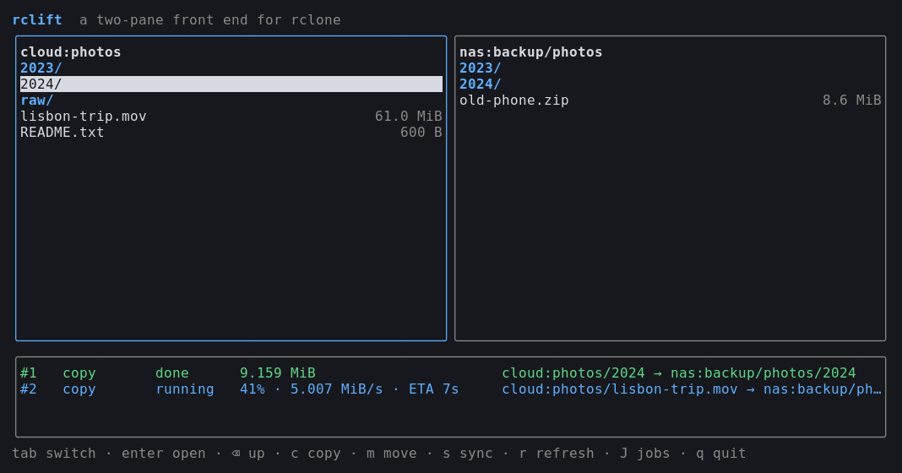
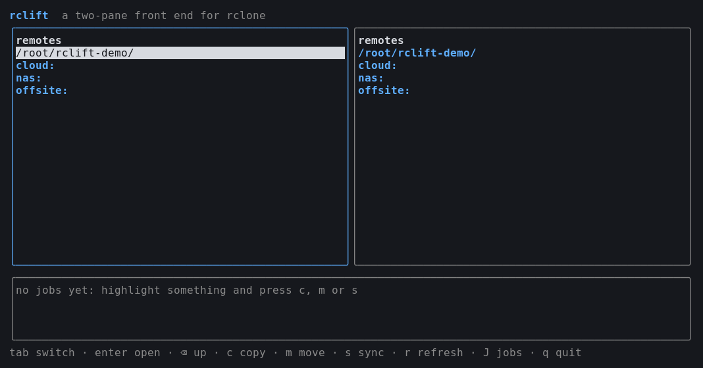
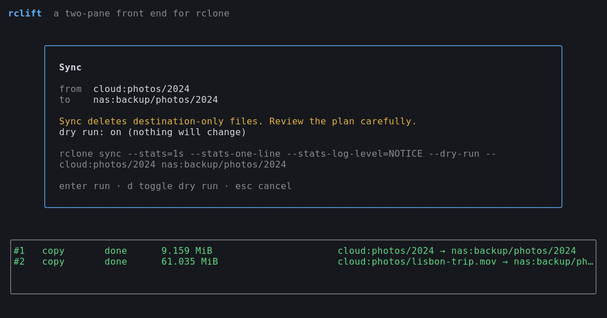

# rclift

[](https://github.com/itsbryanman/RCLIFT/actions/workflows/ci.yml)
[](go.mod)
[](https://rclone.org)
[](https://github.com/charmbracelet/bubbletea)
[](LICENSE)
[](#limitations)

Two panes, your rclone remotes, and a queue of copy / move / sync jobs. Basically Midnight Commander if it only knew how to talk to rclone.

I got tired of typing `rclone sync gdrive:Some/Long/Path nas:Some/Other/Path`, getting one character wrong, and finding out the hard way. rclift lets you *point* at the source and the destination instead, shows you the exact command before it runs, and refuses the ones that would eat your data.



## Install

You need [rclone](https://rclone.org/install/) on your `PATH`, with at least one remote set up (`rclone config`). rclift doesn't touch your rclone config; it just shells out to the binary.

```sh
go install github.com/itsbryanman/RCLIFT/cmd/rclift@latest
```

Or from a checkout:

```sh
go build -o rclift ./cmd/rclift
```

## Using it

```sh
rclift                          # both panes start at the remote picker
rclift gdrive:photos /mnt/nas   # or open two locations directly
```

The picker lists every remote from `rclone listremotes`, plus the directory you launched from so local files are one keypress away.



Highlight something on one side, open the folder you want it to land in on the other side, and press `c`, `m` or `s`. Folders keep their name, so copying `gdrive:photos/2024` into `nas:backup` gives you `nas:backup/2024`, which is what a file manager would do and **not** what bare `rclone copy` does. Single files go straight into the open folder.

Before anything runs you get a confirmation box with the full `rclone …` command line. Nothing happens until you hit enter.



While a job runs, the list at the bottom shows percent, speed and ETA; once it's done you get the total size.

| key | what it does |
| --- | --- |
| `tab` | switch panes |
| `↑` `↓` / `j` `k` | move around (`g`/`G`, `PgUp`/`PgDn` work too) |
| `enter` / `→` | open a folder or remote |
| `backspace` / `←` | go up; from a remote's root this takes you back to the picker |
| `c` / `m` / `s` | copy / move / sync the highlighted item into the other pane |
| `d` | in the confirm box: toggle `--dry-run` |
| `r` | reload both panes |
| `J` | jump into the job list; `x` cancels the selected job, `esc` comes back |
| `q` | quit (asks twice if something is still transferring) |

### Flags

```
-rclone string   path to the rclone binary (default "rclone")
-jobs int        how many transfers may run at once (default 2)
-version         print version and exit
```

## Things it won't let you do

Sync deletes files on the destination that aren't in the source. That's the whole point of sync, and it's also how people lose their photo library. So:

- **Sync starts as a dry run.** The confirm box says so, and you have to press `d` to make it real. The border turns red when you do.
- **Nested paths are refused.** `gdrive:` → `gdrive:backup`, `gdrive:backup` → `gdrive:`, `/data` → `/data/old`: all rejected before rclone ever gets called. Same for source == destination, including sneaky ones like `r:dir/` vs `r:dir`.
- **No sync of a single file.** It doesn't do anything useful and it's almost always a misclick. Use copy.
- **Quitting stops your transfers properly.** If jobs are running you get asked again, and on the way out every rclone process gets cancelled and waited on, so you don't leave orphaned transfers behind.

When rclone itself fails, you see what rclone said (`Bad Authorization: 403 Forbidden`, say), not just `exit status 1`.

## Limitations

Things I know about and haven't gotten to:

- One item at a time. No multi-select yet.
- The nesting check works on paths, so it can't tell that an `alias` or `union` remote points somewhere inside another remote. If you've got remotes like that, treat dry run as mandatory.
- Linux only so far. macOS will probably just work; Windows won't, because `C:\` looks a lot like a remote name to the path logic.
- Job output keeps the last 8 KB per job, which is plenty for the progress line but not a full log. If you need the full log, run that command yourself with `--log-file`.
- No delete, rename or mkdir. Use `rclone` directly for those for now.

## Hacking on it

```
cmd/rclift/          flags, startup checks, shutdown
internal/rclone/     thin wrapper around the rclone binary (no shell involved)
internal/operation/  copy/move/sync specs and the safety checks
internal/jobs/       the transfer queue
internal/ui/         the Bubble Tea front end
```

```sh
go test -race ./...
```

The UI tests drive the model with a fake rclone, so they don't need network or credentials. The rclone adapter has one test that uses the real binary on a temp dir, and it skips itself if rclone isn't installed.

## License

MIT. See [LICENSE](LICENSE).
